# System Architecture & UML Class Diagram
**Designed by:** John Emmanuel Balbalosa (System / Design Lead)

---

## 1. Layered Package Structure
```text
src/
├── model/          # Domain entities, interfaces, inheritance hierarchies, validation
├── exception/      # Custom checked exceptions for business rules and file I/O
├── data/           # CSV persistence and .txt receipt file writer (FileHandler)
├── service/        # Core business logic, authentication, overdue engine (MarketManager)
└── console/        # Interactive CLI menus, formatted ASCII tables, input helpers
```

---

## 2. UML Class Diagram (Mermaid)

```mermaid
classDiagram
    direction TB

    class Storable {
        <<interface>>
        +toCsv() String
        +getId() String
    }

    class User {
        <<abstract>>
        -String id
        -String username
        -String passwordHash
        -String fullName
        +getRole()* String
        +getAccessLevel()* int
        +canDelete()* boolean
        +checkPassword(String plain) boolean
        +hash(String plain)$ String
        +toCsv() String
    }

    class Admin {
        +getRole() String
        +getAccessLevel() int
        +canDelete() boolean
    }

    class Staff {
        +getRole() String
        +getAccessLevel() int
        +canDelete() boolean
    }

    class Stall {
        <<abstract>>
        -String id
        -String section
        -String size
        -String category
        -String status
        -String vendorId
        -String billingType
        -double rate
        +isOccupied() boolean
        +computeRent()* double
        +getStallType()* String
        +toCsv() String
        +fromCsv(String line)$ Stall
    }

    class DryGoodsStall {
        +computeRent() double
        +getStallType() String
    }

    class WetStall {
        +computeRent() double
        +getStallType() String
    }

    class FoodStall {
        +computeRent() double
        +getStallType() String
    }

    class Permit {
        <<abstract>>
        -String id
        -String vendorId
        -String permitNumber
        -LocalDate issueDate
        -LocalDate expiryDate
        +getPermitType()* String
        +getStatus() String
        +getDaysUntilExpiry() long
        +toCsv() String
        +fromCsv(String line)$ Permit
    }

    class SanitaryPermit {
        +getPermitType() String
    }

    class BusinessPermit {
        +getPermitType() String
    }

    class Vendor {
        -String id
        -String name
        -String contact
        -String business
        -LocalDate dateRegistered
        -String stallId
        -LocalDate paidUntil
        +setContact(String contact) void
        +toCsv() String
        +fromCsv(String line)$ Vendor
    }

    class Payment {
        -String id
        -String vendorId
        -double amount
        -LocalDate paymentDate
        -String periodCovered
        -LocalDate paidUntil
        +toCsv() String
        +fromCsv(String line)$ Payment
    }

    class FileHandler {
        +loadUsers() List~User~
        +saveUsers(List~User~) void
        +loadVendors() List~Vendor~
        +saveVendors(List~Vendor~) void
        +loadStalls() List~Stall~
        +saveStalls(List~Stall~) void
        +loadPayments() List~Payment~
        +savePayments(List~Payment~) void
        +loadPermits() List~Permit~
        +savePermits(List~Permit~) void
        +saveReceipt(String content, String fileName) String
        +exportCsv(String filePath, List~String~ lines) void
    }

    class MarketManager {
        -FileHandler fileHandler
        -List~User~ users
        -List~Vendor~ vendors
        -List~Stall~ stalls
        -List~Payment~ payments
        -List~Permit~ permits
        +login(String username, String password, String role) User
        +addVendor(...) Vendor
        +assignStall(String stallId, String vendorId) void
        +recordPayment(...) Receipt
        +addPermit(...) Permit
        +getOverdueRecords() List~OverdueRecord~
        +getPermitsNeedingRenewal(int days) List~Permit~
        +getOccupancySummary() int[]
    }

    class OverdueRecord {
        -Vendor vendor
        -Stall stall
        -double amount
        -long daysOverdue
        -long periods
    }

    class Receipt {
        -String text
        -String filePath
    }

    Storable <|.. User
    Storable <|.. Stall
    Storable <|.. Permit
    Storable <|.. Vendor
    Storable <|.. Payment

    User <|-- Admin
    User <|-- Staff

    Stall <|-- DryGoodsStall
    Stall <|-- WetStall
    Stall <|-- FoodStall

    Permit <|-- SanitaryPermit
    Permit <|-- BusinessPermit

    MarketManager --> FileHandler : persists via
    MarketManager o-- User
    MarketManager o-- Vendor
    MarketManager o-- Stall
    MarketManager o-- Payment
    MarketManager o-- Permit
    MarketManager ..> OverdueRecord : computes
    MarketManager ..> Receipt : generates
```



---

## 3. Business Rules & Polymorphic Pricing Matrix
| Stall Category | Subclass | Surcharge Rule | Sample Base Rate | Computed Rent |
| :--- | :--- | :--- | :--- | :--- |
| `DRY` | `DryGoodsStall` | `rate * 1.00` (Base rate) | PHP 1,500.00 / mo | PHP 1,500.00 |
| `WET` | `WetStall` | `rate * 1.10` (+10% water/drainage upkeep) | PHP 1,800.00 / mo | PHP 1,980.00 |
| `FOOD` | `FoodStall` | `rate * 1.20` (+20% utility/sanitation fee) | PHP 300.00 / day | PHP 360.00 |
